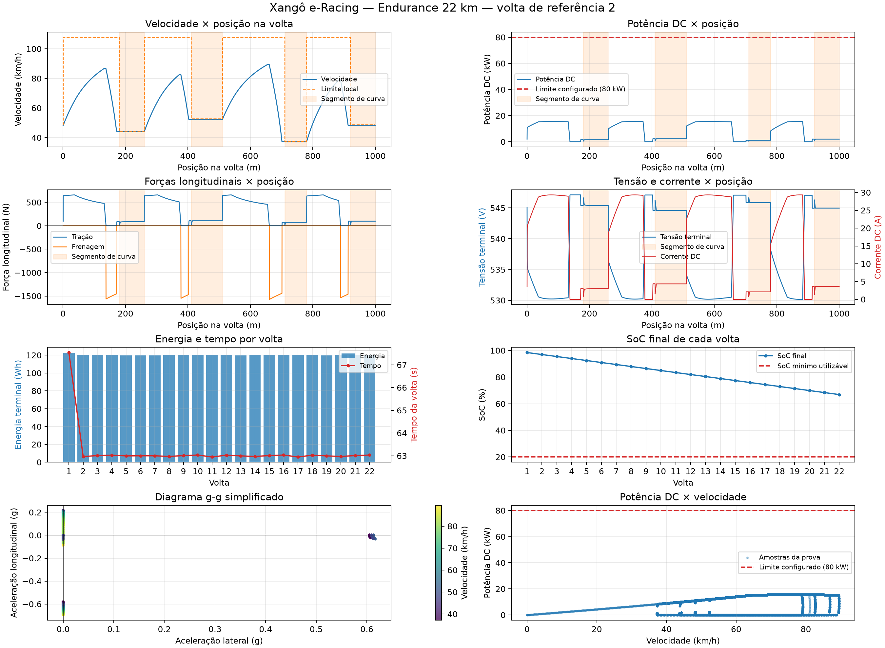

# Simulador físico de Endurance — Xangô e-Racing

Modelo longitudinal e energético preliminar para um Endurance de 22 km. O
simulador não foi validado experimentalmente e o percurso de referência não é
uma pista real de competição. O código original em `src/` permanece separado e
é usado apenas como fonte rastreável de alguns parâmetros e equações.

## Execução

No Windows, abra `Endurance_Real/run_endurance.py`, selecione o interpretador
`.venv/Scripts/python.exe` no VS Code e clique em **Run Python File (▶)**.

Execução equivalente no PowerShell:

```powershell
.\.venv\Scripts\python.exe Endurance_Real\run_endurance.py
```

Linux/macOS, com um ambiente virtual equivalente:

```bash
./.venv/bin/python Endurance_Real/run_endurance.py
```

Ao final, o terminal mostra os resultados sem imprimir caminhos de arquivos e
uma única janela Matplotlib apresenta o dashboard interativo. Para automação:

```powershell
$env:ENDURANCE_NO_SHOW = "1"
.\.venv\Scripts\python.exe Endurance_Real\run_endurance.py
```

Essa variável desativa somente a janela. PNGs e NPZ continuam sendo gerados.

## Arquitetura

- `config/parameters.py`: dataclasses com dados conhecidos e hipóteses.
- `models/vehicle.py`: resistências, cargas normais e aderência combinada.
- `models/drivetrain.py`: transmissão e massa equivalente.
- `models/motor.py`: envelope quase-estático do PMSM.
- `models/battery.py`: tensão, corrente, SoC e perdas resistivas.
- `models/braking.py`: cadeia hidráulica e força efetiva de frenagem.
- `simulation/track.py`: sequência longitudinal de segmentos e limites locais.
- `simulation/endurance.py`: piloto virtual e integração no tempo.
- `simulation/results.py`: históricos, resumo por volta e NPZ.
- `visualization/plots.py`: dashboard 4×2 e nove PNGs.
- `tests/`: verificações físicas, numéricas e de execução.
- `results/`: relatórios e artefatos reproduzíveis.

## Dinâmica longitudinal

```text
m_eq dv/dt = F_tração - F_freio - F_aero - F_rolamento - F_inclinação
F_aero = 0,5 ρ Cd A v²
F_rolamento = Crr (1 + |v|/v_ref) m g cos(θ)
F_inclinação = m g sin(θ)
F_downforce = 0,5 ρ (Cl_f A_f + Cl_r A_r) v²
```

A massa equivalente soma massa translacional e inércias rotacionais uma única
vez. O fator de forma `0,80` da inércia das rodas é uma hipótese configurável;
não é um valor medido. A referência de velocidade do rolamento é `150 m/s`,
preservando a unidade do modelo de origem.

## Pneus e aderência combinada

Tração, frenagem e limites de curva usam uma única fonte:
`TireConfig.friction_coefficient`. O valor atual `0,60` é uma hipótese do
cenário, não o fator `lambda_mu` da Magic Formula original.

```text
Fx,max = sqrt[(μ Fz)² - Fy²]
Fy = m v²/R
v_curva = sqrt[μ m g / (m/R - μ 0,5ρ(Cl_f A_f + Cl_r A_r))]
```

O círculo de atrito é uma aproximação isotrópica. Não há parâmetros laterais
experimentais, slip angle, transientes de pneu ou Magic Formula combinada. O
downforce participa de `Fz`. A tração usa a carga traseira com transferência
longitudinal; a frenagem ainda usa um limite agregado do veículo.

## Motor, transmissão e potência

```text
T_max = 1,5 p λm iq,max
P_mec,max = P_DC,max η_motor η_inversor
F_roda = (T_motor - kf ωmotor) N ηtrans / rroda
P_DC = P_motor / (η_motor η_inversor)
```

As eficiências são constantes. Não existem mapas dependentes de rotação,
torque, tensão ou temperatura. O limite de 80 kW é configuração do projeto e
não uma declaração de conformidade regulamentar.

## Piloto virtual

O controlador possui estados `ACCELERATING`, `CRUISING` e `BRAKING`.

- Nas retas, o alvo é 99% do limite cinemático do powertrain.
- O acelerador usa feedforward de resistência e termo proporcional.
- A taxa de variação do acelerador é limitada.
- O segmento-alvo fica travado durante cada evento de curva.
- O piloto freia antes da curva e não executa *trail braking*.
- Frenagem regenerativa permanece desabilitada.

Por isso, o diagrama g-g tende a mostrar grupos separados de frenagem
longitudinal e aceleração lateral. Isso é consequência da estratégia e da
simplificação do modelo, não evidência experimental do envelope do pneu.

## Bateria e energia

O modelo avalia uma formulação Modified Shepherd simplificada por célula e
escala tensão e resistência para o pack 144s5p:

```text
V_terminal = V_aberto(SoC, carga acumulada) - R_eq I
P_DC = V_terminal I
I = 2 P_DC / [V_aberto + sqrt(V_aberto² - 4 R_eq P_DC)]
dSoC/dt = -I / (Q_pack 3600)
P_Joule = I² R_eq
```

Energia nos terminais é `∫V_terminal I dt`. A soma dessa energia com
`∫I²R_eq dt` fornece somente uma estimativa da energia interna retirada sob o
modelo resistivo adotado; não é medição exata de energia química. O SoC deriva
da carga integrada, e não de uma proporção fixa entre Wh e capacidade nominal.

## Pista e voltas

A “volta” de 1 km é apenas uma sequência de retas e raios usada pelo modelo
longitudinal. Ela não possui coordenadas 2D nem fechamento geométrico validado;
a soma angular informada dos segmentos é aproximadamente 722,7°, não 360°.
Consequentemente, o simulador não desenha um mapa da pista.

As voltas 2–22 são quase periódicas. A primeira inclui a largada e tem tempo e
energia diferentes. Ao longo das voltas seguintes, a queda de SoC altera a OCV,
a tensão terminal e as perdas, embora o cenário atual não modele temperatura.

## Dashboard e exportações

O dashboard usa a volta 2 como referência local e apresenta:

1. velocidade e limite local;
2. potência DC;
3. forças longitudinais;
4. tensão e corrente;
5. energia e tempo por volta;
6. SoC final por volta;
7. diagrama g-g simplificado;
8. potência DC por velocidade.



O diretório `results/` recebe o dashboard, oito painéis individuais e
`endurance_results.npz`. O NPZ inclui estados do piloto, metadados de voltas e
segmentos, forças e históricos elétricos.

## Parâmetros conhecidos e hipóteses

Dados preservados do projeto incluem massa de 240 kg, raio de roda de 0,26 m,
Cd 0,7789, área frontal 0,68 m², relação 5:1, eficiências mecânicas 0,98 e
0,97, parâmetros do PMSM e configuração genérica 144s5p.

Principais `ASSUMPTIONs` configuráveis:

| Hipótese | Valor atual |
|---|---:|
| Percurso longitudinal | 1 km repetido até 22 km |
| μ simplificado | 0,60 |
| Eficiência do motor | 90% |
| Eficiência do inversor | 95% |
| Margem do alvo de reta | 99% |
| Ganho proporcional do piloto | 2,0 |
| Limite de taxa do acelerador | 3,0 s⁻¹ |
| Margem energética | 20% |
| SoC mínimo utilizável | 20% |
| Passo de integração | 0,02 s |
| Fator de inércia das rodas | 0,80 |

## Uso para dimensionamento

O modelo pode apoiar comparações preliminares de energia nos terminais,
potência DC, corrente, consumo específico e influência de hipóteses. Ele não é
suficiente para aprovar um acumulador: faltam tensão mínima/máxima e corrente
contínua/de pico da célula, limites térmicos, envelhecimento, curva OCV×SoC,
resistência em função de SoC/temperatura, mapas de eficiência, telemetria real e
requisitos regulamentares aplicáveis.

### Resultado do cenário atual

Para o cenário executado de 22 km, o modelo calcula 2.642,36 Wh entregues nos
terminais e 69,94 Wh dissipados em `R_eq`. A estimativa interna é 2.712,30 Wh.
Com margem de 20% e janela utilizável de 80%, a estimativa nominal mínima é
4.068,45 Wh, equivalente a 7,64 Ah na tensão nominal de 532,8 V.

O pack genérico 144s5p possui 15 Ah e 7.992 Wh nominais, portanto atende ao
critério energético do cenário. Isso **não aprova** a configuração: tensão
máxima/mínima, corrente de célula, C-rate permitido, temperatura, isolamento,
proteções e regras aplicáveis continuam pendentes. A corrente simulada chega a
29,46 A no pack, ou 5,89 A por célula no arranjo 5p.

Uma configuração 144s3p seria o mínimo inteiro apenas pelo critério de energia;
ela não é recomendação, pois os limites de corrente e tensão da célula são
desconhecidos.

## Testes

Windows:

```powershell
$env:MPLBACKEND = "Agg"
.\.venv\Scripts\python.exe -m unittest discover -s Endurance_Real\tests -v
```

Linux/macOS:

```bash
MPLBACKEND=Agg ./.venv/bin/python -m unittest discover -s Endurance_Real/tests -v
```

Os testes cobrem aderência, limites de curva, potência DC, SoC, controlador,
inversões de comando, convergência temporal, distância final, resumos por
volta, conservação energética, dimensionamento preliminar, NPZ, dashboard e
execução direta. A sensibilidade completa pode ser reproduzida com:

```powershell
.\.venv\Scripts\python.exe Endurance_Real\scripts\sensitivity_energy.py
```

## Créditos e publicação

Projeto relacionado ao Powertrain da equipe Xangô e-Racing. Os parâmetros e
equações adaptados preservam os créditos dos modelos originais do repositório.
Nenhuma licença nova é criada aqui. Licença, publicação e permissões sobre os
códigos originais dependem de decisão da equipe.
